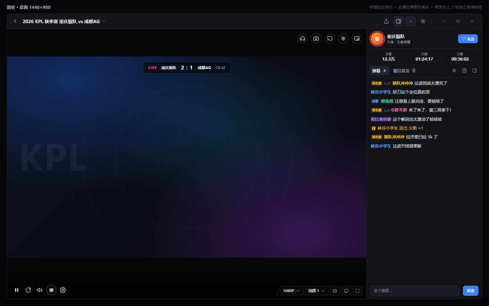
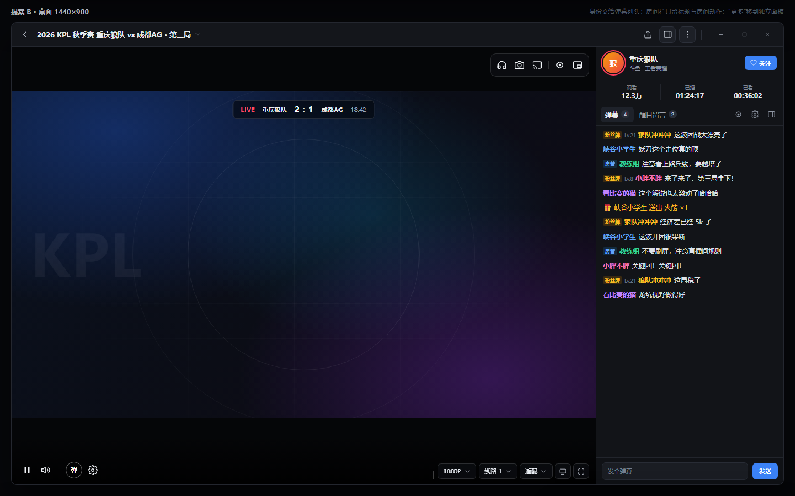
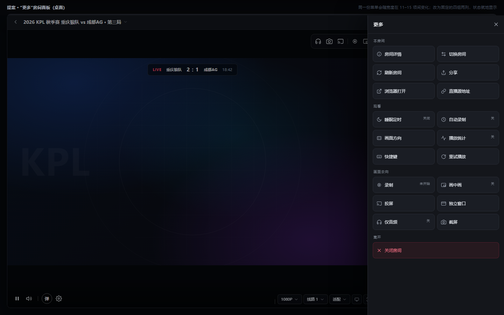
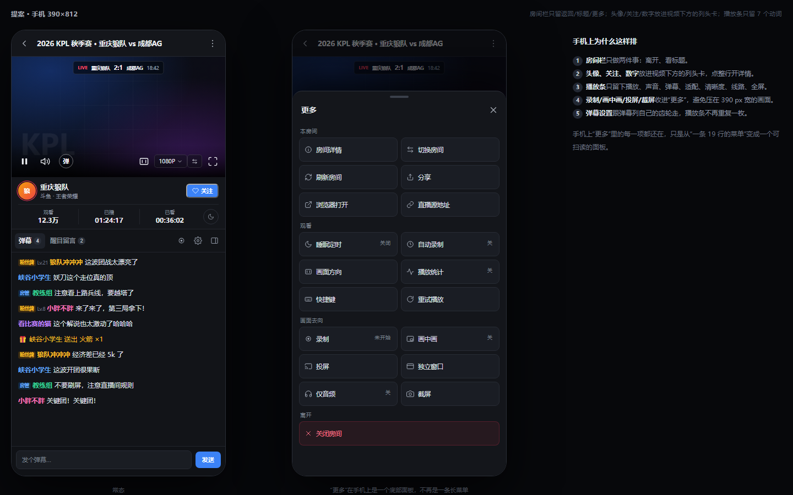

# 直播间播放页：控件与布局设计

> **已被 [live-room-simple.md](live-room-simple.md) 的“减法版”取代**（尤其是“更多”部分）。本页保留作 B 方案记录。
>
> 状态：**讨论稿，只做设计，未改代码。** 确认后再按第 9 节拆批实施。
>
> 范围：`RoomPage`（页内 / 全屏 / 窗口全屏 / 竖屏全屏 / 手机横屏 / TV）与 `PlayerSurface` 的控制层；不含播放内核、弹幕引擎、设置页。
>
> 图是 HTML 画的布局示意，不是 Flutter 截图；比例、间距、字号按 `DsSpace` / `DsSize` 的现有档位取值，颜色取主题深色档。









> 手机端没有“弹幕列”，所以同一个列头组件放在视频下方，当作房间卡；房间栏只留标题。

---

## 0. 结论先行

现在的页面不是“控件没地方放”，而是**同一个东西有好几个门，菜单又按窗口宽度补位**。你选了保留弹幕列头的显示方式，所以方案 B 的收法是：

| 层 | 只放什么 | 高度 |
| --- | --- | --- |
| **房间栏** | 离开、标题、分享、弹幕列开关、更多、窗口三键 | 44（触屏 48） |
| **弹幕列头** | 头像、主播名、平台·分区、关注、观看/已播/已看 | 约 110（保留现有样式） |
| **弹幕列** | tabs + 列表 + 输入框 | 340 默认（280–520） |
| **画面** | 右上：画面去向（仅音频/截屏/投屏/录制/画中画）；底部：播放 + 播什么（播放/静音/弹幕/清晰度/线路/适配/全屏） | 满铺 |
| **更多面板** | 房间级动作，四组、两列、条目固定 | 390 侧栏 / 底部 sheet |

一句话：**宽屏的身份交给弹幕列头，房间栏只留标题和房间动作；弹幕列收起时由画面左上胶囊接手；录制/画中画/投屏留在画面右上；“更多”从一条会变形的菜单变成一个固定的动作面板。**

窄屏没有弹幕列，同一个“列头组件”放在视频下方，当作房间卡；房间栏只留标题和更多。

---

## 1. 现状诊断

### 1.1 现在的结构

```
房间栏 40/44 ┌ ←  标题▾（宽）/ 头像+主播名（窄） … 分享  弹幕列  更多▾  主题  窗口三键
             ├───────────────────────────────────────────┬──────────────────────
             │ 画面（满铺）                               │ 弹幕列 340
             │  右上：耳机 相机 投屏 录制 画中画（5 枚独立）│  头部：头像/名字/平台·分区
             │                                            │        关注 + 3 格数字（约 100–110）
             │  底部：▶ 重试 静音 弹 齿轮 │ 1080P 线路 适配 ▣ ⛶ │  tabs：弹幕 / 醒目留言 + 录制/设置/屏蔽
             │                                            │  列表
             └───────────────────────────────────────────┴  输入框
窄屏：画面（16:9）/ 房间卡（3 行）/ 弹幕列
```

### 1.2 六个具体问题

**① 身份重复，最多四处。**
房间栏是 `_RoomHeader`（窄，`room_page.dart:1786`）或 `_RoomTitleBar`（宽，`:1759`）；宽屏弹幕列头又是 `_ChatRoomHeader`（`:1870`，头像、名字、平台·分区、关注、观看/已播/已看）；聊天列收起时画面左上再出现 `_AnchorFollowChip`（`player_surface.dart:2098`）；窄屏和竖屏 sheet 还有 `_RoomHero`（`:2473`）；详情面板又是一版（`room_details.dart:21`）。1440×900 上，房间栏和弹幕列头同时说“这是谁”。

**B 方案不是删列头，而是删房间栏里那份重复**：宽屏房间栏只留标题，头像/名字/数字/关注都由列头说；列头收起时，画面左上胶囊接手。列头本身保留现在的样式和 110 px 的高度。

**② 宽屏收起弹幕列后，房间详情没有入口。**
`_RoomTitleBar` 旁边的 `chevronDown` 不响应点击（`:1780`，没有 `onPressed`）；`roomMenuItems` 的“房间详情”只在 `immersive` 时加入（`:2207`）；宽屏页内传给播放层的 `immersive` 是 `false`，所以画面右上也没有菜单；`_AnchorFollowChip` 的 `onTitle` 在宽屏为 `null`（`:2134`）。结果是：**宽屏把弹幕列一收，页内就找不到房间详情的入口**——只能先进全屏，再从全屏菜单里绕进去。切到画面浮流模式同理。B 方案保留列头后，要补齐三个门：列头可点（已有）、房间栏标题可点（要加）、列头收起时画面左上胶囊可点（要加）。

**③ “更多”是按宽度补位的菜单，不是一个稳定的地方。**
同一份动作集合共 19 项，实际显示 11–15 项：

- `stripHasCluster = MediaQuery.width >= 460`（`:2201`）决定录制、画中画、投屏、适配、仅音频是否出现在菜单里；
- `immersive` 决定详情、关注、截屏是否出现（`:2207`、`:2221`、`:2305`）；
- 于是“更多里有什么”取决于窗口多宽、是否全屏，用户记不住；
- 入口图标是 `chevronDown`（`:2409`），和标题旁那个不能点的箭头同形；
- 最后一项文案是 `common.close`（“关闭”，`:2374`），实际动作是**退出房间**。

**④ 画面上的控件没有主次。**
右上 5 枚独立玻璃胶囊（仅音频、截屏、投屏、录制、画中画，`player_surface.dart:1976-2005`），底部 8–10 个控件（`:2940-3053`）；重试紧挨播放（`:2956`），误触成本高；统计、画面方向、直播源这类低频项反而和清晰度同级。

**⑤ 窄屏的房间栏和房间卡太厚。**
390 px 宽时房间栏有返回、主播、关注（带文字）、分享、更多；视频下面还有 3 行房间卡（头像、数字、标题），弹幕区被压到一半。标题在房间里出现得比主播名晚——要滚过画面才看到。

**⑥ 几个一致性缺口。**
标题箭头不可点；主题切换塞在房间栏（`:1686`）；房间栏的“关注”和弹幕列头的“关注”是两个按钮（同状态、两处代码）；截屏同时有画面按钮、菜单项、`S` 键三个门，但没有一处说明它们是一件事。

---

## 2. 设计规则

1. **一个视口，身份只说一次。** 宽屏由弹幕列头说，房间栏只留标题；列头收起时由画面左上胶囊接手；窄屏由房间栏 + 房间卡说；全屏由画面左上玻璃条说。
2. **栏上是快捷方式，面板里是索引。** 同一个动作允许“栏上按钮 + 更多里的条目”，但不允许两个栏同时承载同一个动作。
3. **宽度只决定露出多少，不决定“更多里有什么”。** 条目集合固定，能力不满足才隐藏（如内核不能截屏、平台没有外链）。
4. **状态留在画面，动作收进面板。** 录制中、画中画、睡眠倒计时、自动录制等待这些“正在发生”的事，要有常驻标记；开始/停止的入口可以收。
5. **详情、关注、分享、退出，任何模式都要有门。** 这是②的教训。
6. **房间栏不加高。** 桌面 44、触屏 48，不再做第二条页头；宁可少放一个按钮。

---

## 3. 控件归属表

> “以后”一列是唯一常驻位置；“更多”是索引，不作为唯一入口的会在备注里写明。

| 功能 | 现在在哪 | 以后在哪 | 备注 |
| --- | --- | --- | --- |
| 返回 / 退出全屏 / 退出房间 | 房间栏左、全屏左上 | 房间栏左；全屏左上 | 行为不变：优先退模式，再退房间 |
| 主播头像 / 名字 | 房间栏、弹幕列头、画面左上、房间卡、详情 | **弹幕列头**（宽屏）；**房间卡**（窄屏，同一个列头组件）；全屏玻璃条；画面左上胶囊（列头收起） | 房间栏不再放头像/名字 |
| 标题 / 平台·分区 | 房间栏标题、弹幕列头、房间卡、详情 | 标题在**房间栏**（宽窄都放）；平台·分区在**弹幕列头**（宽）/房间卡（窄） | 标题可点开详情；宽 <1000 省略标题 |
| 直播中 / 回放 | 画面顶栏（全屏）、房间卡、详情 | 弹幕列头的头像直播环 + 名字旁 `回放` 徽标；房间卡徽标；全屏玻璃条 | 列头补一个回放徽标，现在只有头像环 |
| 观看数 / 已播 / 已看 | 弹幕列头 3 格、房间卡、详情 | **弹幕列头 3 格**（宽）；**房间卡 3 格**（窄）；详情 | 同一套数字，位置随布局 |
| 关注 | 房间栏（仅窄）、弹幕列头、画面左上、全屏菜单、详情 | **弹幕列头**（宽）；**房间卡**（窄）；画面左上胶囊（列头收起）；全屏玻璃条；详情 | 房间栏不再重复 |
| 分享 | 房间栏、详情 | 房间栏图标（桌面）；更多（手机）；详情 | 手机上不占房间栏 |
| 房间详情 | 房间卡、弹幕列头、全屏菜单 | **点弹幕列头**、点房间栏标题、房间卡、画面左上胶囊、更多 | 修②：任何模式都有门 |
| 切换房间 | 更多 | 更多 / 本房间 | 也可从播放列表滑动（既有） |
| 刷新房间 | 更多 | 更多 / 本房间 | |
| 在浏览器打开 | 更多、详情 | 更多 / 本房间；详情 | 按平台能力显示 |
| 复制链接 | 详情 | 详情 | 更多里不再重复 |
| 直播源地址 | 更多 | 更多 / 本房间 | 按平台能力显示 |
| 播放 / 暂停 | 底栏、Space、双击 | 底栏左 1；Space；双击 | 双击仍是全屏，不改 |
| 静音 | 底栏 | 底栏左 2 | 滚轮/上下拖调音量，沿用 |
| 音量 | 滚轮、上下拖、方向键 | 不变 | 不加滑杆，避免第二套读数 |
| 弹幕开关 | 底栏 | 底栏（弹字） | |
| 弹幕设置 | 底栏齿轮、弹幕列 tab 齿轮 | 弹幕列 tab 齿轮（主）；底栏齿轮（快捷） | 两个门同一个设置 tab，可接受 |
| 清晰度 | 底栏 | 底栏右：`1080P▾` | 窄屏只留当前值 |
| 线路 | 底栏 | 底栏右：`线路▾` | 只有一条时不出现 |
| 画面适配 | 底栏（宽）/ 更多（窄） | **底栏右：适配**（宽出文字，窄出图标） | 不再进更多，保证手机可达 |
| 播放统计 | 更多、`I` | 更多 / 观看；`I` | |
| 截屏 | 画面右上、更多（全屏）、`S` | 画面右上（桌面/全屏）；更多（手机）；`S` | 能力位门控 |
| 录制 | 画面右上、更多（窄）、弹幕列录制 tab | 画面右上；更多；录制中胶囊 | 停止入口在胶囊上，沿用 |
| 画中画 | 画面右上、更多（窄） | 画面右上；更多 | 不支持时整项消失 |
| 投屏 | 画面右上、更多（窄） | 画面右上；更多 | 无可用线路时不出现 |
| 独立窗口 | 更多 | 更多 / 画面去向 | 仅桌面且开着“多窗口”设置 |
| 仅音频 | 画面右上、更多（窄） | 画面右上；更多 | |
| 窗口全屏 | 底栏 | 底栏右 | 桌面 |
| 竖屏全屏 | 底栏（宽 + 竖流） | 底栏右；竖屏 sheet 的手柄 | 只在竖流出现 |
| 全屏 | 底栏最右、F、双击 | 底栏最右；`F`；双击 | |
| 睡眠定时 | 更多、房间卡 chip | 更多 / 观看；房间卡 chip（窄） | 运行时房间栏“更多”带小圆点 |
| 自动录制 | 更多 | 更多 / 观看 | 等待开播时按钮带状态 |
| 画面方向 | 更多 | 更多 / 观看 | 每房间偏好，低频 |
| 快捷键 | 更多、`?` | 更多 / 观看；`?` | |
| 重试播放 | 底栏（紧挨播放） | **错误状态卡**；更多 / 观看；`R` | 从主播放条移走，避免误触 |
| 关闭房间 | 更多最后一项（写作“关闭”） | 更多 / 离开（红色，写作“关闭房间”） | 返回键仍可退出 |

---

## 4. 布局规格

### 4.1 桌面 ≥1200

```
┌ 房间栏 44 ───────────────────────────────────────────────────────────────┐
│ ←  标题（可点，省略）……………………………………                ⇪  ▥  ⋮   ─ □ ✕ │
├───────────────────────────────────────────────┬──────────────────────────┤
│                                               │ [头像] 主播名      [关注] │
│                                               │ 斗鱼 · 王者荣耀           │ 110
│                 画面（满铺）                   │ 观看 12.3万 ｜ 已播 01:24 ｜ 已看 00:36 │
│                                               ├──────────────────────────┤
│   [耳机│相机│投屏│ ●录制│画中画]  ← 一个胶囊    │ 弹幕 4   醒目留言 2  ◉ ⚙ ▥ │ 44
│                                               ├──────────────────────────┤
│  ▶  🔊 │ 弹 ⚙            1080P 线路 适配 ▣ ⛶  │  消息                     │
│                                               │  [输入框]          [发送] │
└───────────────────────────────────────────────┴──────────────────────────┘
```

- 房间栏一行：返回 → 标题（可点开详情，省略）→ 分享 → 弹幕列开关 → 更多 → 窗口三键。**不放头像、名字、数字、关注。**
- 弹幕列头保留现在的显示方式：头像（直播环）、主播名、平台·分区、关注、观看/已播/已看三格；整块可点开详情。名字旁补一个 `回放` 徽标——现在回放房间只有头像环变色，看不出是回放。
- 列头收起/切到画面浮流时，画面左上出现同一身份胶囊（头像 + 名字 + 关注），**胶囊可点开详情**；房间栏标题仍然可点。
- 去掉标题旁不能点的箭头（或保留箭头但让它真的打开详情）。
- 主题切换默认移出房间栏（它是全局设置，不属于这个房间）；如果你想保留，P0 留着即可，不影响其它布局。
- 弹幕列：头部保留，下面是 tabs；宽度拖拽、折叠、流模式都沿用现有逻辑。
- 画面右上：一个玻璃胶囊装 5 个图标，中间用 1 px 分隔；只有控制条醒着的时候出现；录制中/画中画进行中是例外，状态胶囊常驻。
- 画面底部：左簇 `▶ / 🔊 / 弹 / ⚙`，右簇 `清晰度 / 线路 / 适配 / 窗口全屏 / 全屏`；重试不在条上。
- 统计面板仍然从顶栏下方展开（`player_surface.dart:1366` 的现有规则），不会和右上胶囊打架。

### 4.2 840–1199

- 布局同 4.1；标题始终保留、只是省略，不隐藏——列头收起时它是唯一的“播什么”。
- 弹幕列宽 280–420，舞台地板 420 不变；列头在 280 宽时平台·分区自然省略，三格数字仍放得下。
- 清晰度/线路/适配在 <960 时只出图标。
- 840 宽时右簇是：分享、弹幕列、更多、窗口三键；关注在列头。

### 4.3 手机 <840

```
┌ 房间栏 48 ─────────────────────────────┐
│ ←  标题（可点，省略）              ⋮   │
├────────────────────────────────────────┤
│              画面 16:9                  │
│ ▶ 🔊 弹            适配 1080P 线路 ⛶   │
├────────────────────────────────────────┤
│ [头像] 主播名                 [关注]    │
│ 斗鱼 · 王者荣耀                         │
│ 观看 12.3万 ｜ 已播 01:24 ｜ 已看 00:36 🌙 │
├────────────────────────────────────────┤
│ 弹幕 4   醒目留言 2          ◉ ⚙ ▥      │
│ 消息 …                                  │
│ [输入框]                         [发送] │
└────────────────────────────────────────┘
```

- 房间栏只留：返回、标题（可点开详情）、更多。头像、关注、分享都从房间栏移走。
- 视频下方放**同一个列头组件**：头像、主播名、平台·分区、关注、三格数字；右侧睡眠胶囊。约 100 px，整块可点开详情。
- 播放条 7 个：`▶ / 🔊 / 弹 / 适配 / 1080P / 线路 / ⛶`。
- 录制、画中画、投屏、截屏不在手机上压画面，进“更多”；录音中仍保留左上角胶囊。
- 竖屏流的底部三停 sheet、横屏手机的窄弹幕列**不改**；横屏时没有房间卡，身份在画面左上条与窄弹幕列里。

### 4.4 TV

- 房间栏保留（遥控需要焦点入口）；画面常显两条横条，48 px 控件、8 px 间距、2 px 白焦点环，沿用 A8/D1 的档位。
- 右上胶囊在 TV 上加宽间距；更多面板 420 px，打开时焦点锁在面板内，返回键先关面板。
- 不引入 hover 的临时显隐：TV 的条一直开着。

### 4.5 全屏 / 窗口全屏 / 竖屏全屏

- 没有房间栏；画面左上玻璃条 = 返回 + 头像 + 名字 + LIVE + 观看数；右上 = 呈现胶囊 + 更多；底部 = 同一条播放条。
- 更多面板从右侧进来；打开时**收起沉浸式弹幕抽屉**，关闭后抽屉恢复。两者不抢同一条边。
- 窗口全屏/PiP 的窗口三键不在画面里重复：窗口 chrome 自己负责。

### 4.6 竖屏 sheet / 手机横屏

- 竖屏 sheet：没有房间栏可放标题，房间卡保留现在的 `_RoomHero`（含标题）；tabs 和列表不变。
- 手机横屏：标题继续在画面左上条，右侧弹幕列不变；只做播放条去重试、右上胶囊合并。

---

## 5. “更多”面板规格

### 5.1 形态

- 从房间栏的 `⋮` 或画面右上（全屏）打开。
- ≥640 px：右侧面板，宽 390（TV 420），从顶部盖到窗口底部；带遮罩并接管点击（模态），点外部或 Esc 关闭。
- <640 px：底部 sheet，圆角 18，高度约 70%，可下拉关闭；内容滚动。
- 复用 `RoomPanelScope`（详情/睡眠已有），新增 `RoomPanelKind.actions`；同一时间只开一个面板。

### 5.2 内容（四组，固定 19 项）

| 组 | 条目 | 状态显示 |
| --- | --- | --- |
| **本房间** | 房间详情、切换房间、刷新房间、分享、在浏览器打开、直播源地址 | 能力不满足的项隐藏 |
| **观看** | 睡眠定时、自动录制、画面方向、播放统计、快捷键、重试播放 | 睡眠：关闭 / 29:14；自动录制：关 / 等待开播；统计：关；重试：加载中禁用 |
| **画面去向** | 录制、画中画、投屏、独立窗口、仅音频、截屏 | 录制：未开始 / 02:31；画中画：关 / 进行中；仅音频：关 |
| **离开** | 关闭房间（红色，整行） | 文案明确“关闭房间”，不再叫“关闭” |

- 两列网格，tile 46–48 px，图标 16 + 文字 12；每组的标题是 10 px 字距大写。
- 条目**不随宽度增减**；只有能力位（截屏、外链、直链、画中画、投屏、独立窗口）决定是否出现。
- 面板本身不写新偏好；所有状态读现有 provider。
- 新文案 4 个：本房间 / 观看 / 画面去向 / 离开（其余动作复用现有键）。

### 5.3 状态与反馈

- 开关型条目就地切换，不关面板（睡眠、自动录制、统计、仅音频、画中画）；动作型条目关面板再执行（切台、分享、浏览器打开、关闭房间）。
- 睡眠/自动录制在运行时，房间栏的 `⋮` 带 5 px 圆点；进入面板后对应 tile 右侧显示倒计时/“等待开播”。
- 录制中：面板里的“录制”显示计时，画面左上的常驻胶囊仍在（C17 的行为），两处都能停。
- 能力不满足：整项不出现，不放禁用项（与现有 `directLinks`/`external` 的门控一致）。

---

## 6. 交互与状态（沿用 + 新增）

- 控制条自动隐藏 3 秒（`controlsAutoHideSeconds` 设置）、悬停唤醒、点画面切换、双击全屏、上下拖音量/亮度、`F`/`T`/`I`/`S`/`R`/`?` 快捷键**全部不变**。
- 暂停、缓冲、失败、慢速时条常驻的规则不变。
- 锁定（lock）时条不出现、录制胶囊只读：不变。
- 新增：弹幕列头、房间栏标题、画面左上胶囊都可点开详情（列头收起时也有门）。
- 新增：更多面板打开时，Esc / 返回键 / 点外部关闭；TV 遥控返回键先关面板。
- 新增：面板打开时不抢播放快捷键；输入框聚焦时键盘仍归输入框。
- 新增：面板里的开关改完后，房间栏/画面上的状态同步（同一个 provider，不做第二份真相）。

---

## 7. 主题与平台

- 房间栏、房间卡、弹幕列、面板用主题的 `surface` / `canvas` / `border` / `textMuted`；画面上的胶囊、字幕条继续用固定的 on-video 白/黑（`OnVideoColors`、`playerInk`），不随浅色主题反色。
- 选中态（弹幕开、仅音频、统计开）用 `theme.selectedFill` / `onSelectedFill`，与现有 strip 的开关一致。
- 浅色主题要单独看：面板 tile 的 `#1a1d24` 这类示意色在实现里不能写死，必须是主题 token；画面上的玻璃仍按深色处理。
- 自定义 seed / 高对比：焦点环用主题 focus，TV 用画面白；不新增裸色值。
- 窗口拖拽：房间栏中部继续是 `WindowDragArea`；按钮保留自己的点击。标题可点后，拖拽带只放在空白区，避免“想拖窗口却打开了详情”。

---

## 8. 组件与状态边界

| 层 | 归属 | 说明 |
| --- | --- | --- |
| 房间栏 | `room_page.dart` 私有 `_RoomBar` / `_RoomTitle` | 只读 `roomProvider` 的展示字段；标题/分享/弹幕列/更多各自 `select`，避免整条栏随播放状态重建 |
| 房间卡 | 复用 `_ChatRoomHeader` | 宽屏放在弹幕列首；窄屏放在视频下方；约 100 px；睡眠 chip 只在运行时出现 |
| 画面控制 | `player_surface.dart` | 控件位置是视图职责；录制/画中画/投屏仍调用现有共享函数 |
| 更多面板 | 新 `page/room_actions_panel.dart` | 纯展示 + 回调；动作函数沿用 `toggleRoomRecording`、`toggleRoomPip`、`showRoomDirectLinks` 等 |
| 面板宿主 | `panels/room_panel.dart` | 新增 `RoomPanelKind.actions`；沿用现有路由/焦点/关闭规则 |
| 状态 | 现有 provider | 不加设置键、不加持久化；面板是视图 |

不新增依赖；不新增卡片式模板；不把动作逻辑写进面板 Widget。

---

## 9. 实施拆分

### P0 · 结构去重（先让页面“顺”）

1. `room_page.dart`：新 `_RoomBar`（标题 + 分享 + 弹幕列 + 更多），删标题死箭头；标题可点开详情；主题切换默认移出（可保留）。
2. 宽屏：**保留 `_ChatRoomHeader`**；房间栏去掉头像、名字、数字、关注，只留标题与房间动作。
3. 窄屏：房间卡复用 `_ChatRoomHeader`（头像/关注/三格数字），放在视频下方；房间栏只留标题 + 更多。
4. `player_surface.dart`：重试移出播放条；右上 5 枚胶囊合并成一个玻璃组；窄屏只留录制中/画中画状态。
5. 修②：宽屏收起弹幕列时，画面左上胶囊可点开详情。

**风险**：房间栏在 840–960 的挤压；窗口拖拽与标题点击的手势竞争；关注状态在列头/房间卡/详情/全屏条四处同步。

### P1 · 更多面板

6. 新 `page/room_actions_panel.dart`（四组、两列、19 项、状态文本）。
7. `panels/room_panel.dart` 加 `actions` kind；`room_page.dart` 的 `_RoomMenu` 和 `player_surface.dart` 的菜单入口都改为打开面板。
8. 删除 `roomMenuItems` 的宽度补位逻辑；保留动作函数。
9. l10n 4 个新键；跑 `dart run slang`。

**风险**：沉浸式里面板与右侧弹幕抽屉抢边；TV 焦点锁；面板打开时播放快捷键/输入框焦点。

### P2 · 打磨

10. 更多按钮的运行态圆点；录制/睡眠/自动录制的状态文案。
11. 焦点顺序（房间栏 → 播放条 → tabs → 输入框 → 面板）、语义标签、Esc/返回键。
12. 截屏/统计/快捷键的入口说明一致化；弹幕齿轮与 tab 齿轮的关系写进注释。
13. 测试：宽屏收起弹幕列仍能开详情；面板条目在 390/840/1440 三档一致；TV 焦点。

**预计改动**：`room_page.dart`（大）、`player_surface.dart`（中）、`room_panel.dart`（小）、新 `room_actions_panel.dart`（中）、l10n 4 键。无新依赖，无新设置键。

---

## 10. 验收清单

| # | 场景 | 看什么 |
| --- | --- | --- |
| 1 | 1440×900 桌面 | 房间栏一行不挤；弹幕列无头部；画面右上只有一个胶囊；底栏无重试 |
| 2 | 900×700 | 标题隐藏后身份仍完整；关注/分享/弹幕列/更多都能点到 |
| 3 | 840 宽 | 舞台 ≥420；右簇不换行；弹幕列 280 起 |
| 4 | 390×844 手机 | 房间栏 3 个目标（返回/标题/更多）；列头卡；播放条 7 个；更多打开是底部 sheet |
| 5 | 宽屏收起弹幕列 | 点标题/画面左上胶囊能开详情（当前页内不可达） |
| 6 | 画面浮流模式 | 同上；浮流不压房间栏/播放条 |
| 7 | 全屏 | 左上身份 + 右上胶囊 + 更多；弹幕抽屉与面板不抢边 |
| 8 | 录制中 | 画面左上常驻胶囊 + 更多里的计时一致；两处都能停 |
| 9 | 睡眠/自动录制运行 | 更多按钮有圆点；面板里显示倒计时/等待开播 |
| 10 | 无截屏/无外链/无投屏能力 | 对应条目和按钮整项消失，不留空位 |
| 11 | 浅色主题 / 自定义 seed | 面板、房间栏、房间卡的对比度；画面玻璃不反色 |
| 12 | TV | 48 px 控件、焦点环、面板焦点锁、返回键关面板 |
| 13 | 键盘 | Space/F/T/I/S/R/? 不变；面板打开时 Esc 只关面板 |
| 14 | 窗口拖拽 | 房间栏空白处可拖，按钮可点，标题/列头/胶囊可点开详情 |
| 15 | 断流/加载/离线/回放 | 错误卡有重试；更多里的重试可用；状态卡不被胶囊压住 |

**验证方式**：`dart analyze lib`、`flutter test test/live test/app`、`flutter build bundle`；视觉走查需要真窗（本会话无 GUI，实施后要补截图）。

---

## 11. 需要你定的事

1. **弹幕列头**：已按你的意思保留（方案 B），宽屏列头不动，房间栏只留标题。手机端我把同一个列头组件放到了视频下方（图里第二版），如果你只想宽屏保留、手机维持原来的房间卡，告诉我。
2. **“更多”形态**（推荐面板）：右侧面板 / 底部 sheet，还是继续用分组菜单（改动更小）。
3. **两个取舍**：
   - 重试从播放条移到错误卡 + 更多，是否接受？
   - 分享在手机上收进更多、桌面保留图标，是否接受？

确认后我按 P0 → P1 → P2 做，先交 P0 的可见效果，再补面板。
