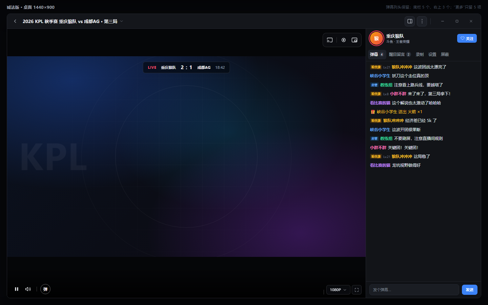
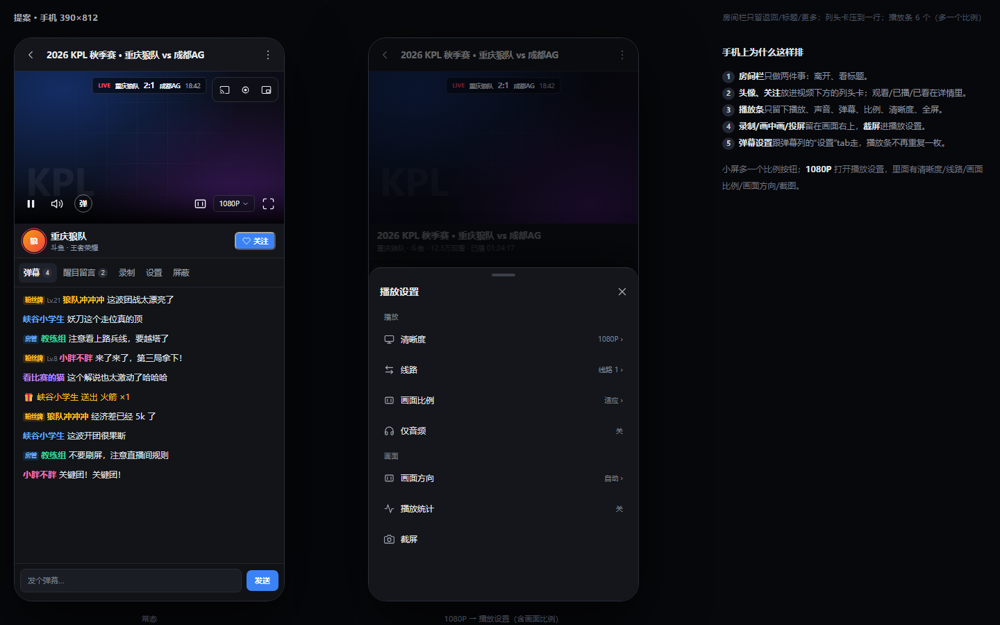

# 直播间播放页：减法版

> **实施回退（2026-11-10）**：按“一个控件一个功能”的反馈，播放条恢复独立控件（重试 / 弹幕设置 / 清晰度 / 线路 / 适配 / 窗口全屏 / 全屏），清晰度、线路、适配直接显示文字（`1080P` / `线路1` / `适应`）；画面右上恢复音频、截图、投屏、录制、画中画；弹幕 tabs 改用 desen_ui 默认间距并横向滚动，设置 tab 改名“设置”；统计 / 画面方向回到“更多”（7 项，手机 6）。下面第 0、2、3 节的“5 个 / 合并播放设置”为历史方案，以本注和代码为准。

> 针对“现在太复杂、更多功能太多、面板也不好看”的反馈。上一版是把 19 项摆整齐；这一版直接**砍到 5 项（手机 3 项）**，列头也压回一行。
>
> 这版取代 [live-room-layout.md](live-room-layout.md) 里的“更多面板”部分；那版留作 B 方案记录。仍然是设计稿，未改 Dart 代码。





---

## 0. 一句话

**「更多」不该是第二个首页。** 它只放“房间级”的 5 件事；清晰度、适配、统计、截图回播放设置；录制、画中画、投屏留在画面右上；详情、分享、外链回房间详情；自动录制回“录制”tab。

数字上的变化：

| 位置 | 现在 | 减法版 |
| --- | --- | --- |
| 画面右上 | 5 枚胶囊（仅音频/截屏/投屏/录制/画中画） | **3 个**（录制/画中画/投屏），合成一个胶囊 |
| 底部播放条 | 8–10 个（含重试、齿轮、线路、适配、窗口全屏） | **桌面 5 个**（播放/声音/弹幕/清晰度/全屏）；**小屏 6 个**（多一个比例） |
| 房间栏 | 6–8 个（分享、关注、主题…） | **4 个 + 窗口三键**（返回/标题/弹幕列/更多） |
| 更多 | 11–15 项，上一版 19 格 | **5 项**（手机 3 项） |
| 弹幕列头 | 头像/名字/平台/关注/三格数字 | **头像/名字/平台/关注**；数字 hover 浮出，手机进详情（高度约 110 → 56） |
| 列头的三个功能入口 | 录制/设置/屏蔽 图标，甩在行尾 | **文字 tab，跟弹幕同组靠左**：弹幕 / 醒目留言 / 录制 / 设置 / 屏蔽 |

---

## 1. 19 项都去哪了

| 功能 | 新家 |
| --- | --- |
| 房间详情 | 点弹幕列头 / 点标题；详情里补**观看/已播/已看**（小屏的数字都在这儿） |
| 切换房间 | 更多 |
| 刷新房间 | 更多 |
| 分享 | 房间详情面板 |
| 浏览器打开 | 房间详情面板 |
| 直播源地址 | 房间详情面板 |
| 睡眠定时 | 更多 |
| 自动录制 | **录制 tab**（“开播时自动录制”开关） |
| 独立窗口 | 更多（仅桌面） |
| 快捷键 | 更多 |
| 清晰度 | 播放设置（底栏 `1080P` 打开） |
| 线路 | 播放设置 |
| 画面适配 | 播放设置 |
| 仅音频 | 播放设置 |
| 画面方向 | 播放设置 |
| 播放统计 | 播放设置 |
| 截屏 | 播放设置（`S` 仍可用） |
| 窗口全屏 | 播放设置 / 窗口（桌面） |
| 录制 | 画面右上 |
| 画中画 | 画面右上 |
| 投屏 | 画面右上 |
| 重试播放 | 错误状态卡（`R` 仍可用） |
| 关闭房间 | 返回 |

19 项没有丢，只是**各自回到对应的对象**：房间的事回详情/更多，播放的事回播放设置，画面去向留画面，录制相关回录制 tab。

---

## 2. “更多”只剩 5 项

一个小菜单（桌面 290 px，手机底部 sheet），一列 5 行：

```
更多
  房间
    切换房间                    ›
    刷新房间                    ›
  工具
    睡眠定时                  关闭
    独立窗口              （仅桌面）
    快捷键
```

- 桌面从房间栏的 `⋮` 打开；手机从 `⋮` 打开底部 sheet。
- 手机没有“独立窗口/快捷键”，所以是 **3 行**：切换房间 / 刷新房间 / 睡眠定时。
- 自动录制不在“更多”：它归“录制”tab 里的“开播时自动录制”开关——那里本来就在管录制任务。
- 没有网格、没有分组大标题、没有第二列；不再像“功能大厅”。
- 状态就地显示：睡眠倒计时。
- 睡眠/录制中在 `⋮` 上点一个小圆点。

---

## 3. 播放设置（替代 4 个零散控件）

底栏的 `1080P` 现在是唯一的“播放设置”入口，点开是一张 320 px 的 popover（手机为底部 sheet）：

```
播放设置
  播放
    清晰度                    1080P ›
    线路                      线路 1 ›
    画面适配                    适应 ›
    仅音频                      关
  画面
    画面方向                    自动 ›
    播放统计                    关
    截屏                          ›
  窗口（仅桌面）
    窗口全屏                    关
```

- 清晰度/线路/适配/音频/方向/统计/截屏/窗口全屏都归到这里；不再各占一个底栏按钮。
- 当前清晰度仍显示在底栏 `1080P` 上，一眼能看见；只是换档要进设置。
- **小屏例外**：底栏多一个比例图标（`▭`），点一下在 适应 → 填充 → 铺满 之间循环并 toast 当前值；要精确选或调“画面方向”，还是进这张播放设置。这样小屏不会因为底栏减负而把比例设置弄丢。
- 比例/方向改变时，播放条和右上胶囊始终贴在舞台边缘，不跟着画面缩放跳动；聊天区不重排。
- 弹幕设置跟弹幕列的 `设置` tab 走，不重复。

---

## 4. 页面本身

### 桌面

```
┌ 房间栏 44 ─────────────────────────────────────────────┐
│ ←  标题（可点）…                    ▥  ⋮   ─ □ ✕      │
├──────────────────────────────────────┬─────────────────┤
│                                      │ 头像 主播  关注  │
│              画面                     │ 平台 · 分区      │
│                                      ├─────────────────┤
│   [投屏｜录制｜PiP]  ← 一个胶囊        │ 弹幕4 醒目2 录制 设置 屏蔽 │
│                                      │ 消息…            │
│  ▶ 🔊 │ 弹          1080P      ⛶      │ [输入框]   [发送] │
└──────────────────────────────────────┴─────────────────┘
```

- 房间栏只留 4 个：返回、标题、弹幕列、更多；窗口三键在最右。分享、关注、主题都移走。
- 右上 3 个输出动作；录制中录制图标变成红色计时胶囊。
- 底栏 5 个；竖屏流才多一个“竖屏全屏”。
- 列头默认只有**头像 / 名字 / 平台·分区 / 关注**（约 56 px）；**观看/已播/已看**在鼠标悬停时从列头下方浮出，不推挤聊天。浮层只读、不拦点击，移开就收；键盘聚焦列头也显示；触屏不出现（去详情看）。
- 列头的三个功能不再用图标、也不再甩到右边：`弹幕` / `醒目留言` / `录制` / `设置` / `屏蔽` 五个文字 tab **全部靠左排**，录制紧挨弹幕；窄屏允许这一行横向滚动。

### 手机

- 房间栏：返回、标题、更多。
- 视频：右上 3 个输出动作；底栏 6 个（播放/声音/弹幕/比例/清晰度/全屏）。
- `1080P` 打开“播放设置”：清晰度、线路、画面比例、仅音频、画面方向、统计、截屏都在里面；比例图标只是快捷循环。
- 视频下方：同一个列头卡，只留头像/主播名/平台·分区/关注；观看/已播/已看在直播间详情里，不再占卡片高度。
- 弹幕 tabs 全部文字：`弹幕` / `醒目留言` / `录制` / `设置` / `屏蔽`，全部靠左。
- “更多”是 3 行的小 sheet（切换/刷新/睡眠），不再铺满 70% 屏幕。

#### 小屏兼容（<840）

- 底栏 6 个：控件 36–38 px、`1080P` 胶囊 52–58 px；320 px 宽仍是一行，不换行。
- 右上 3 个输出动作用 28–30 px 的胶囊，不压字幕、不压比例按钮。
- 列头 5 个文字 tab 一行；<320 px 时这一行横向滚动，不折行。
- 播放设置是底部 sheet，宽度 100%，行高 44；320 px 宽也不横向溢出。
- **比例/方向改变只改画面框**：播放条、右上胶囊、聊天区的高度和位置都不跟着变，避免控件“跳着走”。
- 竖屏三停 sheet、手机横屏沿用原布局，只替换这条底栏和列头。

### 全屏 / TV

- 全屏：左上身份条 + 右上 3 个输出 + 更多；底栏 5 个。
- TV：控件 48 px、常显、焦点环；播放设置与更多同样可用。
- 竖屏 sheet、手机横屏、弹幕面板、快捷键都不动。

---

## 5. 为什么这样更简单

1. **“更多”从 19 变 5（手机 3）**：不再需要滚动、分组、两列网格，一眼看完。
2. **底栏从 10 变 5（小屏 6）**：播放、声音、弹幕、清晰度、全屏；小屏多一个比例，防止设置被藏没。
3. **画面右上从 5 变 3**：只留“画面去哪儿”；音频和截图属于设置，不常驻画面。
4. **列头从约 110 px 压到约 56 px**：三格数字不再常驻；桌面 hover 才浮出，手机进详情。
5. **分享/详情从按钮变“点头像/标题”**：房间事实本来就在详情面板，不需要在三个地方各放一个按钮。
6. **每个东西只有一个家**：想调画质去 `1080P`，想录屏去右上，想自动录制去录制 tab，想分享点列头；不用记“这个在更多里还是底栏里”。

## 6. 代价（需要你知道）

- 清晰度/适配/音频/统计从“一键”变“两下”（先开设置）。当前值仍显示在底栏。
- 小屏底栏多一个比例图标；桌面保持 5 个，比例/方向在 `1080P` 设置里。
- 观看/已播/已看不再常驻列头：桌面 hover 显示，手机进详情。
- 分享、直播源地址进了详情面板；刷新在“更多”里。
- 自动录制从“更多”移到录制 tab，跟着录制任务走。
- 重试只在出错时出现（或按 `R`），不再常驻播放条。
- 独立窗口在“更多”里，仅桌面。

如果还想更少：桌面“更多”可以再砍到 3 项（切换/刷新/睡眠），独立窗口移到窗口菜单，快捷键只保留 `?`。

## 7. 实施边界

- 改：`room_page.dart`（房间栏、列头 hover/详情、手机卡）、`player_surface.dart`（右上 3、桌面底栏 5 / 小屏 6 含比例、播放设置入口）、新增一个 `room_player_settings.dart`（含画面比例/画面方向）、`room_chat.dart`（文字 tabs、录制 tab 里的“开播自动录制”开关）、`room_details.dart`（补观看/已播/已看与直播源地址）、更多菜单从 19 项面板改为 5 项菜单/sheet。
- 不加设置键、不加依赖；播放设置只是现有 provider 的另一个入口。
- 删除上一版的 `room_actions_panel` 19 格方案。
- 验收：桌面 1440/900/840、手机 390/360、TV、浅色/深色、录制中、睡眠中、离线/回放、无截屏能力、宽屏收起弹幕列、全屏。

---

## 8. 需要你确认

1. **“更多”5 项 / 手机 3 项**这个量级可以吗？还想更少的话，桌面可以砍到 3 项。
2. 自动录制放进“录制”tab 的“开播时自动录制”开关，可以吗？
3. 列头默认只留一行、数字 hover/详情，可以吗？
4. 小屏底栏多一个比例按钮（桌面仍 5 个），可以吗？

如果这版方向对，我按这个做；先落地房间栏、列头、文字 tabs、右上 3、底栏 5（手机 6）和“更多”5 项，播放设置随后补。
